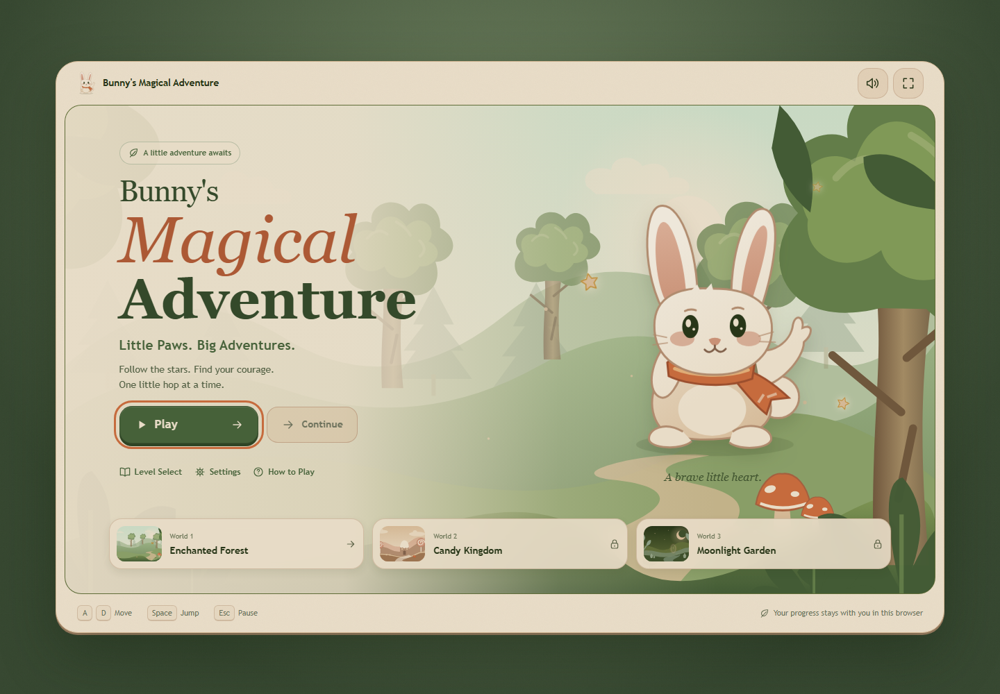
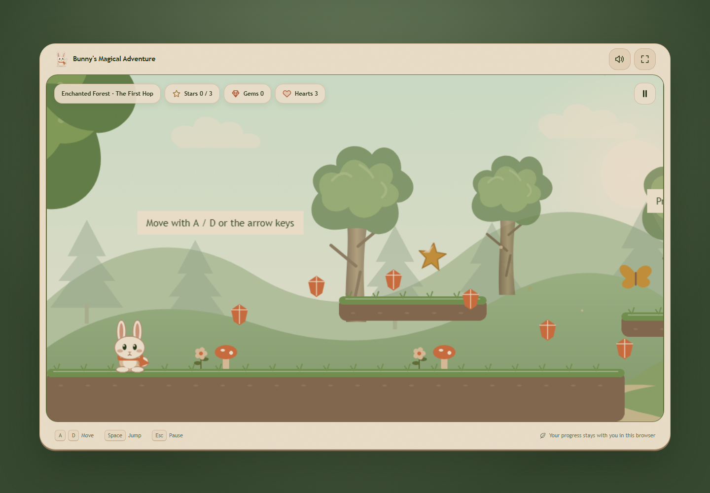

# Bunny's Magical Adventure

## Overview

Bunny's Magical Adventure is a responsive, family-friendly browser platformer with six levels, three illustrated worlds, keyboard and touch controls, local progress, settings, checkpoints, enemies, collectibles, and a complete ending.

## Game Story

A small white bunny follows a trail of magical stars through the Enchanted Forest, Candy Kingdom, and Moonlight Garden. At the end of the trail, a glowing portal carries one final moonlight wish.

## Features

- Six data-driven platforming levels across three worlds
- Acceleration, friction, variable jump height, coyote time, and jump buffering
- Double jump: press the jump key again while airborne to reach higher ledges
- Contextual controls hints disappear after their action is performed and stay dismissed across visits
- Three stars per level, optional gems, patrol enemies, hazards, checkpoints, and moving platforms
- Smooth bounded camera with a dead zone, look-ahead, and layered parallax scenery
- Main menu, world and level selection, pause, game over, level complete, final victory, settings, and help
- Versioned localStorage save data with sequential level and world unlocking
- Keyboard, multitouch, responsive portrait, and landscape support
- Original SVG storybook illustrations, animated cartoon sprites, and synthesized audio with no external asset hotlinks
- Illustrated world cards, a compact HUD, and immediate audio/fullscreen controls
- Native fullscreen where supported, with an edge-to-edge fallback for iPhone and embedded mobile browsers
- Reduced-motion, visible focus, semantic controls, and clear canvas control instructions

## Screenshots





Portrait layouts are also captured in `docs/screenshots/menu-mobile.png` and `docs/screenshots/game-mobile.png`.

## How to Play

Collect up to three special stars in each level, gather optional gems, avoid hazards and friendly-looking patrol creatures, activate checkpoints, and reach the glowing portal. Levels unlock sequentially. Best star and gem results are retained when a level is replayed.

## Controls

| Action | Keyboard | Touch |
|---|---|---|
| Move left | A or Left Arrow | Left |
| Move right | D or Right Arrow | Right |
| Jump | Space, W, or Up Arrow | Jump |
| Double jump | Press the jump key again while airborne | Tap Jump again while airborne |
| Pause | Escape or P | Pause button |

## Game Worlds

- **Enchanted Forest** — The First Hop and Whispering Woods
- **Candy Kingdom** — Sugar Rush and The Jellybean Trail
- **Moonlight Garden** — Starlight Path and The Moonlight Wish

## Technology Stack

Phaser 3.90, TypeScript in strict mode, Vite, Tailwind CSS, Arcade Physics, Vitest, and Playwright. Phaser 3.90 is used as the current stable Phaser 3 line because the game relies on the mature Arcade Physics and scene APIs specified by this project.

## Installation

```bash
npm install
```

## Local Development

```bash
npm run dev
```

Open the URL printed by Vite. No account, backend, or environment variables are required.

## Testing

```bash
npm run typecheck
npm test
npx playwright install chromium
npm run test:e2e
```

Automated tests cover scoring, save validation, progression rules, level data contracts, menu loading, gameplay startup, stable idle collisions, world-preview navigation, saved audio preferences, reduced motion, and a mobile viewport smoke check. Manual playtesting is still recommended for final jump and moving-platform tuning on physical touch devices.

## Production Build

```bash
npm run build
npm run preview
```

The static output is written to `dist/`.

## Cloudflare Pages Deployment

This project supports direct Cloudflare Pages uploads with Wrangler. Once signed in to the intended Cloudflare account, deploy the latest production build with:

```bash
npx wrangler login
npm run deploy:cloudflare
```

The command deploys `dist/` to the `bunnys-magical-adventure` Pages project on its `main` production branch. If starting from a new Cloudflare account, create that project first with `npx wrangler pages project create bunnys-magical-adventure --production-branch=main --force`. The creation-only `--force` option retains direct Pages rather than Wrangler's automatic Workers migration. Existing Pages projects deploy normally without that flag. Direct Upload projects cannot later switch to Git integration without creating a new project; the Git-based alternative below must be configured as a separate project.

1. Push this repository to GitHub.
2. In Cloudflare, open **Workers & Pages**, choose **Create**, then **Pages** and **Connect to Git**.
3. Select the repository.
4. Set the build command to `npm run build`.
5. Set the build output directory to `dist`.
6. Leave the root directory at the repository root and do not add a Worker runtime.
7. Save and deploy.

For a direct upload, run `npm run build` and upload the resulting `dist` directory in Cloudflare Pages. The Vite base path is `/`, so the build is ready for a root Pages domain.

## Project Architecture

- `src/game/scenes` — boot, loading, menu, gameplay, and UI bridge scenes
- `src/game/entities` — the playable bunny
- `src/game/systems` — input, audio, events, and versioned progress
- `src/game/levels` — six typed level definitions and three world themes
- `src/ui` — accessible HTML shell, overlays, HUD, and touch controls
- `src/styles` — responsive Organic storybook design system
- `tests` — Vitest logic tests and Playwright browser smoke tests

## Assets and Licenses

Every visual and audio element is created by project code and owned by the project. See [ASSET_MANIFEST.md](./ASSET_MANIFEST.md). No attribution is required.

The local SVG illustrations live in `public/assets/art/`. The main menu, world cards, and gameplay share the same artwork and palette. To refresh desktop, portrait, tablet, and landscape screenshots while the development server runs, use `node scripts/capture-ui.mjs`.

## Responsive Design

Phaser scales a 960 × 540 gameplay viewport with `FIT` and automatic centering. The HTML shell handles safe areas, narrow screens, accessible overlays, and portrait guidance. Touch targets meet a 44 × 44 px minimum and pointer cancellation clears held movement.

## Saved Progress

Progress and preferences use a versioned browser `localStorage` record. Completed levels, best stars, best gems, unlocked levels, audio settings, reduced motion, and touch-control preferences persist between visits. Clearing site data removes the save. Settings includes a confirmed reset action.

## Live Demo

[Play Bunny's Magical Adventure](https://bunnys-magical-adventure.pages.dev)

Cloudflare Pages production hosting uses the `main` branch. The first deployed version is available at [its immutable deployment URL](https://0a1ec5e6.bunnys-magical-adventure.pages.dev). Re-deploy changes with `npm run deploy:cloudflare`. To run the production browser check, use `node scripts/verify-hosted.mjs https://bunnys-magical-adventure.pages.dev`.

## Future Improvements

- Replace runtime vector textures with a hand-drawn packed sprite atlas
- Add licensed recorded music and richer ambient layers
- Add gamepad input and a remappable controls panel
- Add visual regression snapshots for menu and world themes
